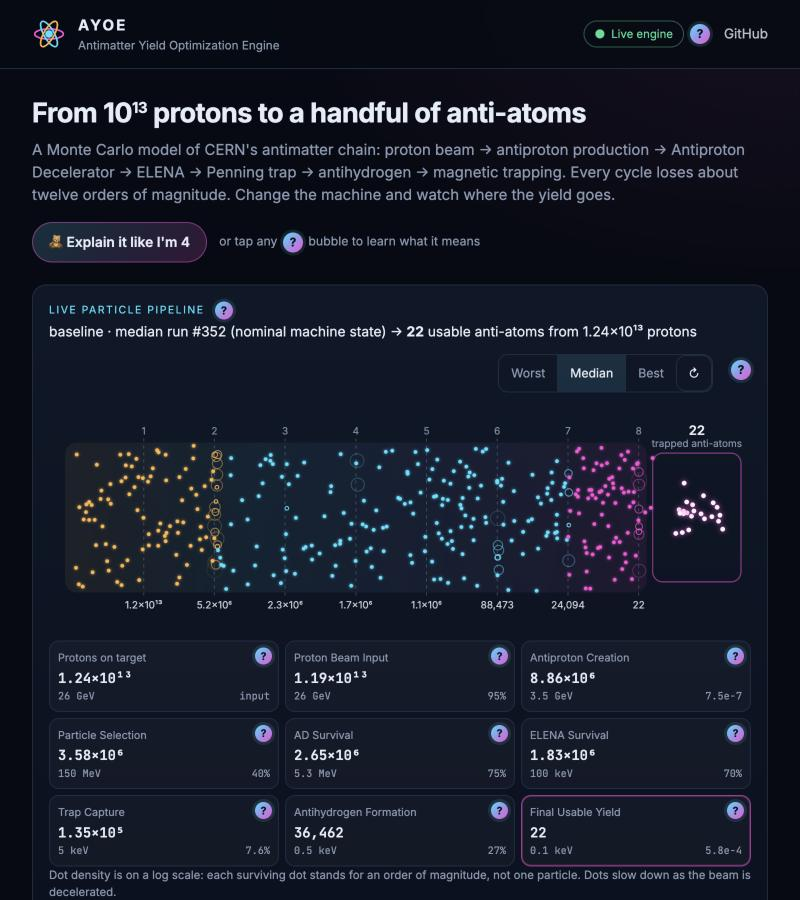
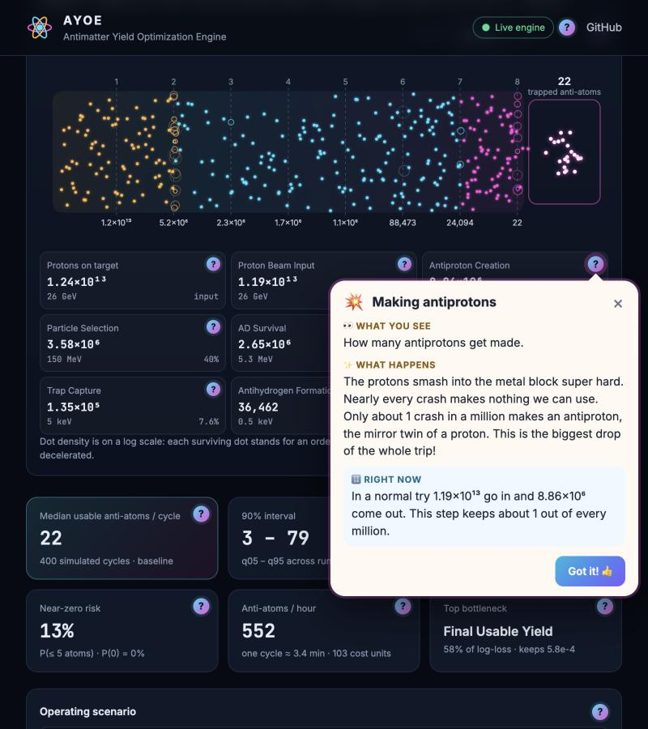
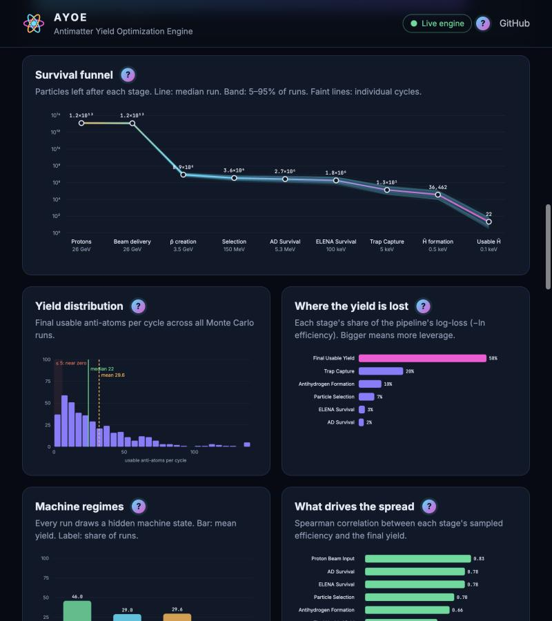
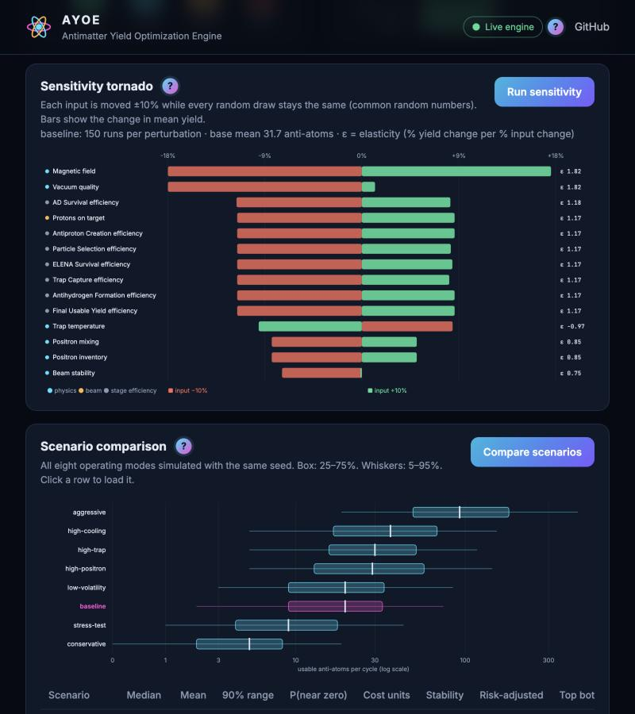
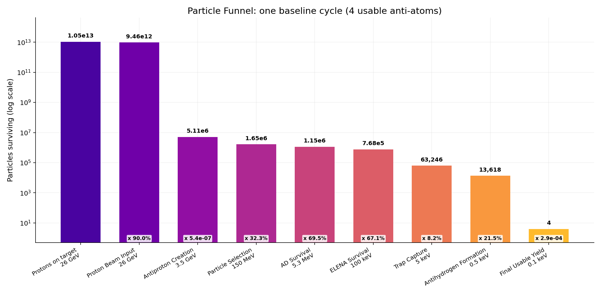
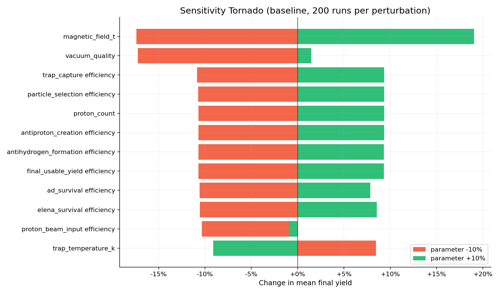
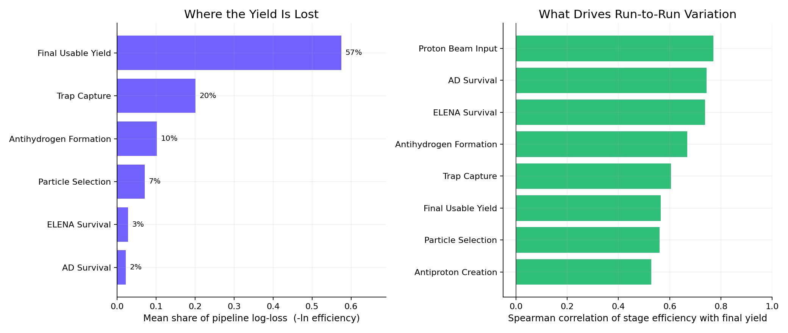
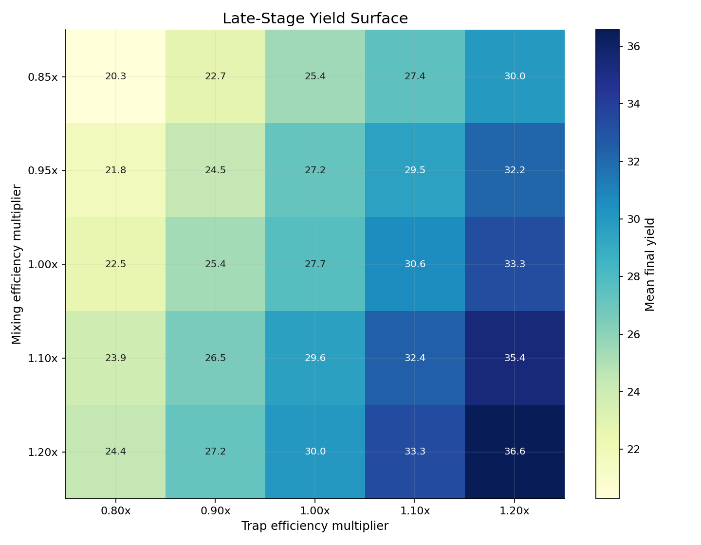
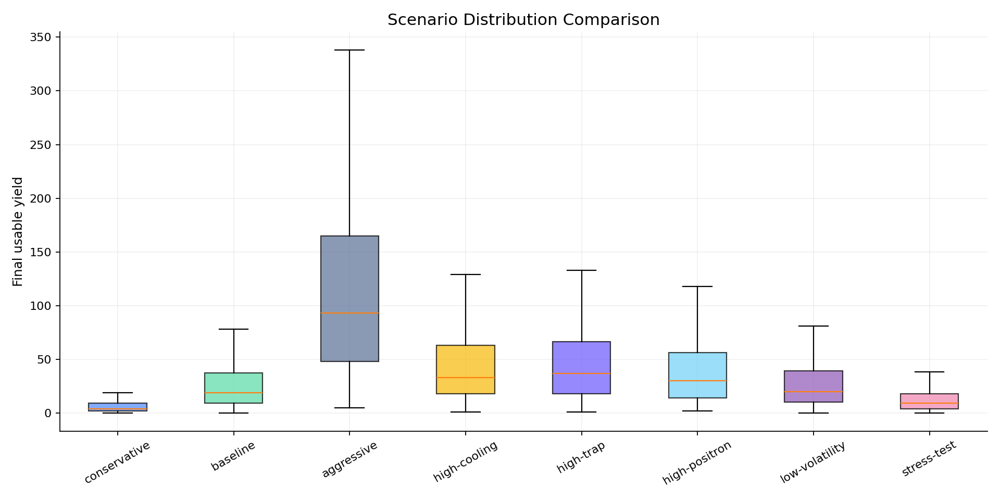

# AYOE: Antimatter Yield Optimization Engine

**A Monte Carlo simulator of CERN's antimatter production chain, from 10¹³ protons to a handful of trapped antihydrogen atoms.**

> [!NOTE]
> **The source code of this project is private.** This repository is its public showcase: the
> README, screenshots and every source file with its types and function signatures, but none of the
> code inside them. For a demo or access to the source code, email me at
> [christodontchev@gmail.com](mailto:christodontchev@gmail.com).

AYOE treats antimatter production as a stochastic pipeline of eight stages. Each one keeps only a fraction of what it receives. The engine plays thousands of production cycles, then shows where the yield is lost, which machine settings matter most, and how risky each operating mode is. It ships with an interactive browser simulator, a CLI, and research-style reports.



---

## Why it's interesting

Making antimatter is the most lossy production line you can build. About **12.5 trillion protons** hit a target to make roughly **ten million antiprotons**. Those are slowed down by two decelerator rings, caught in a Penning trap, combined with positrons into **tens of thousands of antihydrogen atoms**, and in the end **about 20 of them** stay trapped for study.

AYOE's baseline is calibrated to these public orders of magnitude (CERN AD/ELENA operation reports and ALPHA results). The simulated numbers land where the real experiments do:

| Stage (median of 500 baseline cycles) | Simulated | Public reference |
|---|---|---|
| Antiprotons produced per cycle | ~9 × 10⁶ | 6–8 × 10⁶ per pulse (CERN Antiproton Source) |
| Antiprotons trapped | ~1.3 × 10⁵ | ~10⁵ per mixing attempt (ALPHA) |
| Antihydrogen formed | ~3.6 × 10⁴ | 25,000–30,000 per attempt (ALPHA) |
| Antihydrogen trapped (final yield) | **20** (90% of cycles: 3–80) | ~14–20 per trial (ALPHA) |

---

## The visual simulator

The simulator runs the real Python engine behind every click. Nothing is faked in JavaScript.

- **Live particle pipeline.** Dots race through the 8 stages and slow down as the beam is decelerated. Lost particles flash out, and the survivors land in the antihydrogen trap. You can switch between the worst, median and best simulated cycle.
- **Machine knobs.** Sliders for proton intensity, magnetic field, vacuum quality, trap temperature, positron mixing and inventory, target density, pulse length, beam stability and machine volatility. There is also a booster for every stage. Every change re-runs hundreds of cycles in about 0.1 s.
- **Charts.** A log-scale survival funnel with a 5–95% band, the yield distribution with a near-zero risk zone, where the yield is lost, the machine "mood" regimes, and what drives run-to-run spread.
- **Sensitivity tornado** with elasticities, and a **scenario race** across all eight operating modes. Click any scenario to load it.
- **Calibration table** that links each anchor value to its CERN or ALPHA source.

### "Explain it like I'm 4"

Every chart, number, knob and stage has a **?** bubble. Each bubble explains, in very simple words:

- 👀 **What you see:** what's on the screen
- ✨ **What happens:** what is going on in the machine
- 🔢 **Right now:** the live numbers from your current simulation

The **🧸 Explain it like I'm 4** button walks through all of them as a guided tour.



| Charts | Sensitivity and scenarios |
|---|---|
|  |  |

---

## How the model works

Each simulated cycle passes a particle count through eight stages:

| # | Stage | What physically happens | Energy after | Baseline keeps |
|---|---|---|---|---|
| 1 | Proton Beam Input | PS beam delivered onto the production target | 26 GeV | 98.5% |
| 2 | Antiproton Creation | Proton–target collisions produce antiprotons | 3.5 GeV | 8 × 10⁻⁷ |
| 3 | Particle Selection | Momentum selection and transport acceptance | 150 MeV | 42% |
| 4 | AD Survival | Antiproton Decelerator: cooling and deceleration | 5.3 MeV | 78% |
| 5 | ELENA Survival | Extra-low-energy ring decelerates further | 100 keV | 72% |
| 6 | Trap Capture | Penning–Malmberg trap catches antiprotons | 5 keV | 8% |
| 7 | Antihydrogen Formation | Mixing with positrons forms anti-atoms | 0.5 keV | 28% |
| 8 | Final Usable Yield | Neutral anti-atoms held in the magnetic minimum trap | 0.1 keV | 6 × 10⁻⁴ |

On every cycle the engine:

1. **Draws a hidden machine state.** It picks a regime (favourable 15%, nominal 55%, stressed 20%, unstable 10%) and then correlated latent factors for beam quality, cooling, stability and timing.
2. **Samples each stage's efficiency** from a scaled Beta distribution centred on the calibrated value. That draw is then modified by physics inputs (field, vacuum, trap temperature, mixing, …), the latent state, wear, and a random shock, and clamped to physical bounds.
3. **Counts survivors** with Poisson (antiproton production) and binomial draws. Small numbers, like the final ~20 atoms, therefore carry real counting noise.
4. **Tracks cost and duration** per stage, so you can compare yield per hour and yield per cost unit.

### Analysis

- **Monte Carlo statistics:** median, mean, quantiles, coefficient of variation, probability of a near-zero cycle, and expected shortfall.
- **Bottlenecks by log-loss share.** Yield is a product of efficiencies, so each stage's contribution is additive in log space (−ln efficiency). The proton-to-antiproton conversion is reported as the *scale* bottleneck and left out of the operational ranking, because otherwise it would swamp everything else.
- **Sensitivity with common random numbers.** Every input is moved ±10% while the dice rolls stay identical, so the differences come from the parameter and not from noise. Each result is reported as an elasticity.
- **Scenario comparison** across 8 operating modes, ranked by a stability-weighted yield-per-cost score.

---

## Results at a glance

Baseline, 500 cycles, seed 42:

| Metric | Value |
|---|---|
| Median trapped anti-atoms per cycle | **20** |
| 90% interval | 3 – 80 |
| Mean (pulled up by lucky cycles) | 28.3 |
| Cycles with ≤ 5 atoms | 13% |
| Biggest operational bottleneck | Final trapping (57% of log-loss), then trap capture (20%) |
| Most sensitive input | Magnetic field and vacuum quality (elasticity ≈ 1.8) |

Scenario comparison (300 cycles each):

| Scenario | Median | Mean | 90% range | P(≤ 5 atoms) |
|---|---|---|---|---|
| aggressive | 93 | 131.9 | 18 – 369 | 0% |
| high-trap | 37 | 51.8 | 4 – 125 | 7% |
| high-cooling | 33 | 50.4 | 7 – 151 | 4% |
| high-positron | 30 | 43.7 | 4 – 126 | 7% |
| low-volatility | 20 | 29.9 | 3 – 88 | 10% |
| baseline | 19 | 29.9 | 3 – 93 | 12% |
| stress-test | 9 | 13.8 | 1 – 38 | 32% |
| conservative | 4 | 6.9 | 0 – 25 | 59% |

### Report charts

| | |
|---|---|
|  |  |
|  |  |



---

## Project structure

```
src/ayoe/
├── engine.py            simulate_cycle / run_monte_carlo
├── stages.py            the 8 stage simulators, physics and latent modifiers
├── calibration.py       sourced anchors, Beta sampling, latent machine regimes
├── analytics.py         diagnostics, log-loss bottlenecks, correlations
├── sensitivity.py       common-random-number sensitivity with elasticities
├── scenarios.py         8 operating scenarios
├── reporting.py         matplotlib report charts
├── premium_reporting.py guided HTML/Markdown report
├── webapp.py            simulator API server and static demo export
├── web/                 simulator UI (index.html, app.js, explain.js, style.css, data/demo.js)
├── presets/             baseline / conservative / aggressive TOML configs
└── cli.py               `ayoe` command
tests/                   pytest suite (engine, calibration scale, analytics, CLI, web API)
```

---

## Assumptions and limits

AYOE is an educational stochastic model, **not** a beam-dynamics simulation of the real AD and ELENA machines. Stage efficiencies are calibrated to public orders of magnitude, and each one carries a confidence label (see `calibration.py` or the simulator's calibration table). Values marked *low* confidence, such as particle selection and trap capture, are engineering estimates inferred from published bunch sizes. The physics inputs act as smooth multiplicative modifiers rather than first-principles physics. Costs are relative units, not money.

## Sources

- [The CERN Antiproton Source (1983)](https://cds.cern.ch/record/146356/files/HEACC83_14-16.pdf): protons on target and antiproton yield per pulse
- [The Antiproton Decelerator](https://home.cern/science/accelerators/antiproton-decelerator): AD and ELENA deceleration chain
- [ALPHA: Precision measurements on trapped antihydrogen](https://cds.cern.ch/record/2312593/files/arXiv%3A1803.10057.pdf): trapped antiprotons, formation and trapping numbers
- [ALPHA observes the light spectrum of antimatter](https://home.cern/news/press-release/cern/alpha-experiment-observes-light-spectrum-antimatter-first-time): ~25,000 atoms formed, ~14 trapped per trial
- [Production of antihydrogen by 6 keV antiprotons (GBAR)](https://cds.cern.ch/record/2862642/files/CERN-EP-2023-120.pdf): ELENA bunch intensities

## License

© 2026 Christo Dontchev. All rights reserved. The source code is private and is not licensed for
use, copying or distribution; see [LICENSE](LICENSE).
